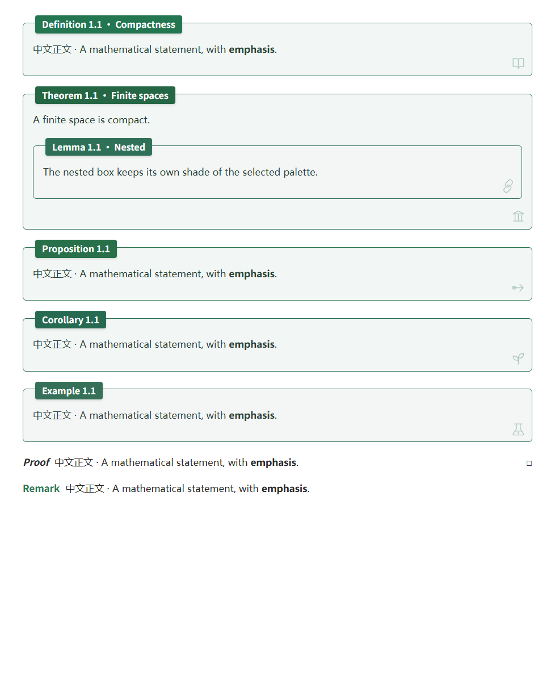
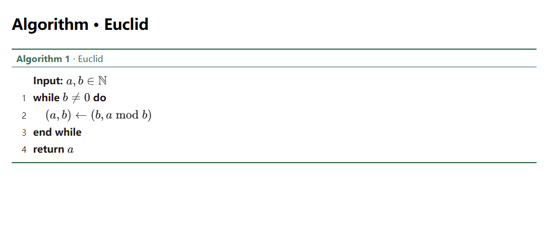
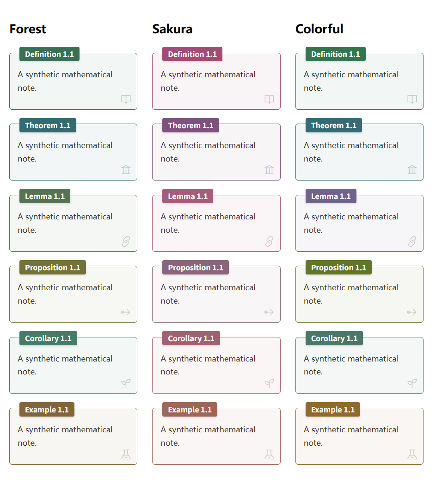
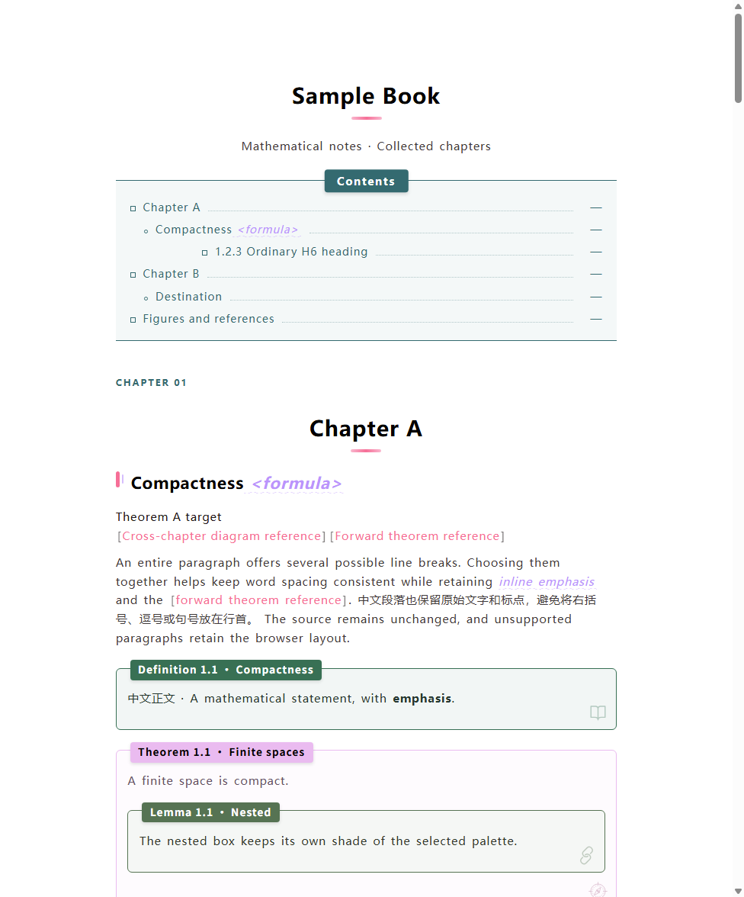

# Academic Notes

[English](README.md) | **简体中文**

为 Obsidian 带来学术写作所需的数学环境、自动编号、交叉引用、绘图与文档导出。

数学环境的视觉设计受到 [ElegantBook](https://github.com/ElegantLaTeX/ElegantBook) 启发：带框的定理、以方框收尾的无框证明，以及用彩色行内标题呈现的简洁注记。

[使用指南](https://github.com/Kristal-Boltinn/academic-notes/wiki/Home-ZH) · [最新版本](https://github.com/Kristal-Boltinn/academic-notes/releases/latest) · [更新记录](CHANGELOG.md)

## 让数学笔记更有条理

- **数学环境**：提供定理、定义、引理、命题、证明、注记等环境，支持折叠和嵌套。
- **灵活编号**：支持自动或手动编号、按节或全文连续计数、共享定理计数器，以及仅为被引用公式编号。
- **跨文件引用**：提供易读的引用标签、插入建议和可自定义的名称与缩写；合订本 PDF 中保留内部跳转。独立公式块还支持 LaTeX 的 `\label`、`\eqref` 和 `\ref` 写法，`\eqref` 可点击跳转，并可用行内 `\label` 只给多行环境中的某一行编号。
- **自建环境**：创建自己的环境，设置编号、引用、颜色与角标。

[数学环境](https://github.com/Kristal-Boltinn/academic-notes/wiki/Mathematical-environments-ZH) · [引用与学术索引](https://github.com/Kristal-Boltinn/academic-notes/wiki/References-and-indexes-ZH)

## 算法、图表与交换图

算法环境沿用 pseudocode.js / LaTeX algorithmic 语法，提供三线样式、可选行号、自动编号和交叉引用。Callout 与代码块两种写法使用同一套渲染。

图片、子图和三线表拥有协调的题注与引用。子图组支持统一图片高度和均衡布局。内置交换图编辑器 **（Beta）** 提供网格节点、数学标签、箭头与三角交换标记；可选 TikZJax 集成可将已渲染的绘图保留到导出文档中。

[算法与伪代码](https://github.com/Kristal-Boltinn/academic-notes/wiki/Algorithms-ZH) · [图片与表格](https://github.com/Kristal-Boltinn/academic-notes/wiki/Figures-and-tables-ZH) · [交换图与 TikZ](https://github.com/Kristal-Boltinn/academic-notes/wiki/Diagrams-and-TikZ-ZH)

## 配色与排版

选择协调的浅色、深色色板，跟随 Obsidian 主题强调色，或创建自定义色板。每套色板独立保存环境颜色与角标。配色、自建环境和引用格式可通过方案文件分享，导入前可预览并选择如何处理冲突。

可选首行缩进与 Knuth–Plass 段落断行 **（Beta）**，优化阅读视图、实时预览中未编辑的内容及桌面 PDF 中的受支持段落；正在编辑或不受支持的内容沿用原生排版。

[外观与自定义](https://github.com/Kristal-Boltinn/academic-notes/wiki/Appearance-and-customization-ZH) · [段落排版](https://github.com/Kristal-Boltinn/academic-notes/wiki/Typography-ZH)

## 整理、检查与导出

- **Markdown 学术索引**：按环境或来源笔记汇总学术内容，生成带普通内部链接、可刷新的索引笔记。
- **引用检查**：查找失效或有歧义的目标、重复块 ID、编号冲突，以及合订本范围外的引用。
- **目录与 PDF 导航**：提供可点击目录、书签、实际测量的页码和内部跳转。
- **单篇与合订本**：导出 HTML 快照或桌面 PDF，将多篇笔记组成章节；导出中的重新编号不改写原笔记。
- **图片跨页保护**：尽量保持图片与图注完整，并提供实验性的缩图与有限段落移动，减少页尾空白。

[目录与导出](https://github.com/Kristal-Boltinn/academic-notes/wiki/Contents-and-export-ZH)

## 桌面与移动端

需要 **Obsidian 1.9.0 或更高版本**。数学环境、编号、引用、索引、外观工具和 HTML 快照可在桌面与移动端使用。**PDF 导出仅限桌面版**，使用 Obsidian 自带的 Electron，无需另外安装导出引擎。界面跟随 Obsidian 的语言，提供英文与简体中文。

Beta 功能有明确的适用范围，排版与触屏表现也可能受到设备和主题影响，兼容性说明见[使用指南](https://github.com/Kristal-Boltinn/academic-notes/wiki/Home-ZH)。

## 本地处理与隐私

索引、交换图渲染与导出均在本机完成，无遥测或开发者账号要求。导出文件保存在笔记库内。主题捕获可能读取已加载的样式、字体和图片，包括主题引用的库外资源；可选集成有各自的行为。资源访问、笔记修改和诊断报告的完整说明见[隐私和权限](https://github.com/Kristal-Boltinn/academic-notes/wiki/Privacy-and-permissions-ZH)。

## 文档

安装、语法、设置和示例已收录在 **[中文 Wiki](https://github.com/Kristal-Boltinn/academic-notes/wiki/Home-ZH)**，也可阅读 **[English guide](https://github.com/Kristal-Boltinn/academic-notes/wiki)**。

[开始使用](https://github.com/Kristal-Boltinn/academic-notes/wiki/Getting-started-ZH) · [排错与兼容性](https://github.com/Kristal-Boltinn/academic-notes/wiki/Troubleshooting-ZH) · [开发说明](https://github.com/Kristal-Boltinn/academic-notes/wiki/Development-ZH)

## 许可

采用 [MIT](LICENSE) 许可。依赖许可与致谢见 [THIRD-PARTY-NOTICES.md](THIRD-PARTY-NOTICES.md)。

## 支持与反馈

如果你觉得 Academic Notes 好用，欢迎在 [GitHub 上点一个 Star](https://github.com/Kristal-Boltinn/academic-notes) 支持项目。遇到问题或有功能建议，欢迎[提交 Issue](https://github.com/Kristal-Boltinn/academic-notes/issues)，帮助插件持续完善。
